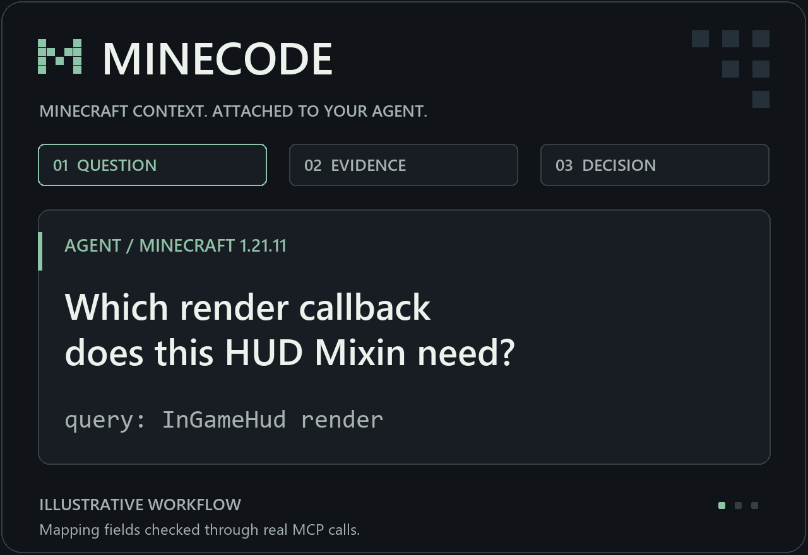
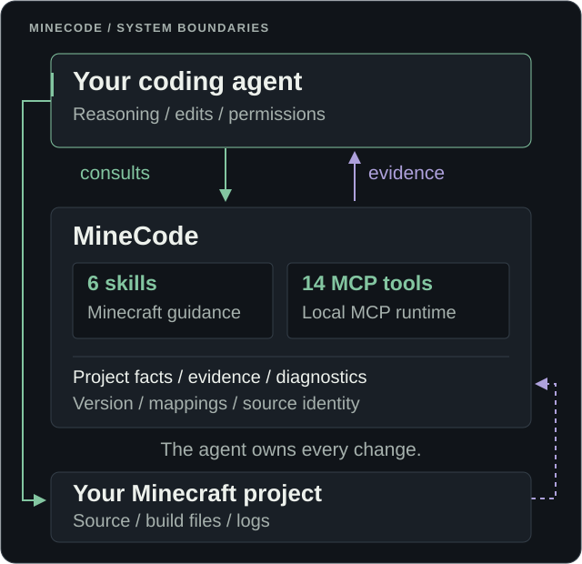

<div align="center">

# MineCode

**A Minecraft-specialized MCP toolkit for Codex, Claude Code, and other coding agents.**


[](LICENSE)

[Install](#installation) &middot; [Tools](mcp/README.md) &middot; [Docs](#documentation) &middot; [Contribute](CONTRIBUTING.md)



Illustrative walkthrough using verified mapping fields. [View the static version](docs/assets/minecode-demo.png).

</div>

## Overview

Minecraft development breaks at the details: versions, mapping namespaces, sides and lifecycle. MineCode supplies focused skills and bounded evidence tools while your agent owns the code.

## What's inside

**Six modular skills**, selected for the work at hand:

| Skill | Focus |
| --- | --- |
| [Java developer](skills/minecraft-java-developer/SKILL.md) | Content mods, registration, resources and shared game logic |
| [Client developer](skills/minecraft-client-developer/SKILL.md) | Rendering, input, modules, settings and lifecycle |
| [Server developer](skills/minecraft-server-developer/SKILL.md) | Plugins, permissions, scheduling and server operations |
| [Project inspector](skills/minecraft-project-inspector/SKILL.md) | Versions, loader, mappings, roots and behavior ownership |
| [Debugger](skills/minecraft-debugger/SKILL.md) | Observed build, Mixin, startup and runtime failures |
| [Anti-cheat compatibility](skills/minecraft-understand-anticheat/SKILL.md) | Legitimate false positives and server validation |

**Fourteen MCP tools**, grouped by responsibility:

| Category | Tools | Purpose |
| --- | --- | --- |
| Project inspection | 2 | Read declared project facts and available local artifacts |
| Retrieval and references | 5 | Find source, documentation and terminology; expand evidence with provenance |
| Diagnostics | 2 | Classify supplied build/runtime failures with explicit uncertainty |
| Build and launch | 3 | Run permitted Gradle tasks, build or attempt a bounded client launch |
| Optional providers | 2 | Check or call separately installed, explicitly configured providers |

Execution, reference downloads and providers are opt-in. [Full tool contracts](mcp/README.md).

## Built for

**Fabric mods. Minecraft clients. Paper plugins.** Mixins, debugging and migrations across existing projects and unfamiliar codebases. Follow the project's actual platform and architecture; don't turn a small mod into a framework.

## See it in action

A HUD Mixin still expects a `float` callback. Ask for the project's mapped signature:

```json
{"query": "InGameHud render", "max_results": 1}
```

The `search_reference_code` / `get_reference_context` workflow returns evidence that can be condensed to:

```text
Minecraft  1.21.11
Mappings   Yarn 1.21.11+build.3
Member     InGameHud.render
Parameters DrawContext, RenderTickCounter
Evidence   Tiny mapping record, not an implementation body
```

These fields were checked through real MCP requests against an independently sourced mapping fixture. The animation illustrates the agent's next decision; it is not a recording of a completed code repair or gameplay test. [Retrieval boundaries](docs/RETRIEVAL.md).

<details>
<summary><strong>Architecture: the agent stays in control</strong></summary>

<p align="center">
  
</p>

</details>

## Installation

**Python 3.11+** and a local skills/MCP-capable host. Clone or download this repository, then run from its root:

```powershell
$minecode = "$env:LOCALAPPDATA\MineCode\runtime"
py -3 -m venv $minecode
& "$minecode\Scripts\python.exe" -m pip install .
```

Connect it to an existing project, using your host:

```powershell
# Codex
& "$minecode\Scripts\minecode.exe" setup --host codex --project "C:\Projects\MyMod"

# Claude Code
& "$minecode\Scripts\minecode.exe" setup --host claude --project "C:\Projects\MyMod"
```

Replace the project path. Open that project, review its trust/MCP prompts and start a fresh session. Ask the agent to call `minecode.get_project_profile` and check the returned project.

Codex has been used interactively. Both setup formats have automated installation checks; live Claude Code model invocation is outside those checks. Other agents can use the same stdio runtime with their own discovery mechanism.

[Linux/macOS, wheels, updates and removal](docs/INSTALLATION.md) &middot; [Troubleshooting](docs/ADVANCED_SETUP.md#health-and-recovery)

### Install with your coding agent

Give your agent this repository link and ask:

> Install MineCode from https://github.com/uruk-king/MineCode for my Minecraft project. Follow its installation guide, ask which host and project to connect, and keep optional execution, downloads and providers disabled unless I request them. Verify the connection afterward. Then ask whether I'd like to star the repository; only star it if I explicitly agree.

Starring is optional and never a condition of installation or use. The installer does not access your GitHub account or star repositories.

## Documentation

| Start here | Go deeper |
| --- | --- |
| [Installation](docs/INSTALLATION.md) / [First task](docs/QUICKSTART.md) | [Architecture](docs/ARCHITECTURE.md) |
| [Skills and workflow](docs/WORKFLOW.md) | [MCP tool reference](mcp/README.md) |
| [Capabilities and limits](docs/CAPABILITIES.md) | [Retrieval and provenance](docs/RETRIEVAL.md) |
| [Troubleshooting](docs/ADVANCED_SETUP.md#health-and-recovery) | [Contributing and development](CONTRIBUTING.md) |

## Know what you're building

**MineCode is a tool, not a substitute for competence.** If you're new to Java or Minecraft development, you're not going to get the best out of it immediately. Use it to learn: understand the language, read the code, and test what you build. Experience and judgment still matter.

If you're going to sell something made with MineCode, put actual effort into it. People deserve more than whatever an AI generates on the first attempt.

Respect other developers and communities. Don't build harmful mods, steal data or sabotage servers. These are voluntary community values, not additional MIT license restrictions.

## Community and contributing

Join the [MineCode Discord](https://discord.gg/PUux9xE6Q9) for community discussion and find videos on [MineCode's YouTube channel](https://www.youtube.com/@MineCodeOnGit). Use the [security policy](SECURITY.md) for vulnerabilities rather than posting sensitive reports in Discord.

**Free, open source, yours to build on.** Star the project if it's useful. Fork it, improve it and take it in your own direction; independent development is encouraged. Give MineCode credit and retain its copyright and license notices.

The main repository is maintenance-focused. Expect updates for major defects, security issues or broken installation, rather than regular feature releases. Community forks are the place to keep building. [Development guide](CONTRIBUTING.md).

[MIT License](LICENSE) &middot; [Third-party notices](THIRD_PARTY_NOTICES.md) &middot; [Evidence policy](docs/EVIDENCE_POLICY.md) &middot; [Security](SECURITY.md)

MineCode is an independent community project, not an official Mojang or Microsoft product. Minecraft and external code, mappings and assets retain their own terms.
